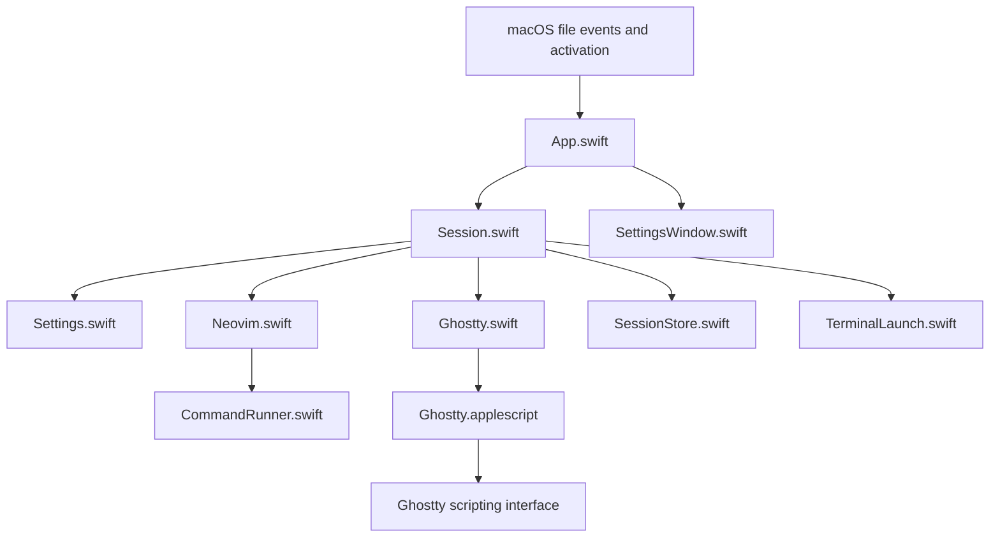

# Neovlet architecture

Neovlet turns macOS file-open events into work for one owned Neovim session in
Ghostty. Swift owns the workflow, persistence, and recovery. A bundled AppleScript
resource provides the Ghostty operations needed by that workflow.

This document describes the current implementation. Start with the
[README](../README.md) for usage and build commands, the [glossary](../GLOSSARY.md)
for terms, and [validation](native-swift-acceptance.md) for coverage and release readiness.

## Behavioral contract

Ownership is limited to the session Neovlet creates and the Ghostty terminal that
hosts it. Recovery verifies that recorded session; it never searches for a manually
started editor to adopt.

| Event | Behavior |
| --- | --- |
| First file batch | Create a tab in the frontmost Ghostty window, or a new window if none exists. Use the first file's parent directory. |
| Later file batch | Verify the same session, deliver files, confirm receipt, and focus the terminal. Preserve the editor's current working directory. |
| Explicit activation without files | Focus the existing session, create an empty editor in the home directory if none exists, or present recovery when state is uncertain. |
| Request received during creation | Wait for that creation and process requests in arrival order. |
| Invalid input | Reject the entire batch before creating a terminal or delivering files. |
| Manager restart | Verify the saved session and reconnect if it is alive. Do not replay interrupted requests. |
| Editor exit | Verify the ended process, safely close its terminal, and remove registration. Quit when no work remains. |
| Uncertain identity or outcome | Preserve evidence, stop dependent work, and require explicit recovery. |
| Quit Manager | Keep the editor and registration. Refuse termination while an operation is active. |

Accepted inputs are existing, readable local regular files, including symbolic links
to regular files. Directories, app bundles, and remote URLs are invalid. Runtime
acceptance does not filter by extension. File-type declarations advertise text,
source, and common configuration files without changing default associations.

Multiple files use Neovim's `:drop` semantics. Neovim may select an existing window,
split when the current buffer cannot be left, or adjust other windows. Neovlet does
not force tabs, discard edits, or override `hidden`, `autowrite`, and related settings.

## Module boundaries

Session exposes two intents: open a batch, or activate without files. Submission is
synchronous; results arrive as ordered, asynchronous notifications. The caller does
not supply endpoints, terminal IDs, retry policy, or recovery stages.

The package contains one executable target and one test target. Production code has
nine Swift files and one AppleScript resource:

| File | Owns |
| --- | --- |
| `Sources/Neovlet/App.swift` | Native entry, AppKit events, menu bar, settings/recovery presentation, and execution of approved termination. |
| `Sources/Neovlet/Session.swift` | The sole intent queue, dependency selection, operation exclusion, reports, recovery, monitoring, and lifecycle decisions. |
| `Sources/Neovlet/Ghostty.swift` | Terminal creation, lookup, TTY verification, focus, safe closure, and scripting-error decoding. |
| `Sources/Neovlet/TerminalLaunch.swift` | Launch handshake, bounded layout wait, and the executable's internal editor-launch branch. |
| `Sources/Neovlet/Neovim.swift` | Known-endpoint RPC, server/TUI association, file delivery, and receipt confirmation. |
| `Sources/Neovlet/SessionStore.swift` | Registration encoding, atomic persistence, synchronization, namespace locking, and conservative cleanup. |
| `Sources/Neovlet/Settings.swift` | User choices, dependency discovery, and validation. |
| `Sources/Neovlet/SettingsWindow.swift` | First-run and later settings, path selection, validation feedback, and diagnostics. |
| `Sources/Neovlet/CommandRunner.swift` | Subprocess argv, output collection, deadlines, termination, and reaping. |
| `Resources/Ghostty.applescript` | Fixed Ghostty handlers with structured arguments and results. |
| `Resources/Info.plist` | Static application identity, deployment target, background presentation, Automation explanation, and file types. |
| `Resources/Neovlet.entitlements` | Apple Events permission-request entitlement used for signing. |
| `scripts/build.sh`, `scripts/build.swift` | Temporary build environment, compilation, app assembly, and signing checks. |
| `scripts/release.sh` | Production signing, notarization, stapling, packaging, and checksums through the same build path. |

Production adapters and test doubles meet at platform and storage boundaries. Small
related types stay close to their users. App has no second queue, and the package
needs no public library target or general dependency-injection framework.

## Settings and dependency snapshots

Dependencies are runtime user choices. Settings live in `settings.json` outside the
signed bundle. Saving a path does not establish that it will remain valid.

| Dependency | Resolution |
| --- | --- |
| Ghostty | Discover through its system bundle identifier or accept an explicit app selection. Validate identity, executable, and required scripting capabilities. |
| Neovim | Try common installation entry points or accept an explicit executable. Validate Neovim identity and required RPC behavior without depending on Finder's `PATH`. |

Store stable entry points, following symbolic links for validation. The file chooser
disables `NSOpenPanel.resolvesAliases` so a package-manager link remains the selected
path instead of becoming a version-specific directory. Ambiguous discovery requires
a user choice; moved or invalid dependencies require repair rather than a silent switch.

The first request validates its whole file batch before dependency resolution.
Missing or ambiguous choices open the same Settings window used from the menu bar.
Neovlet uses installed dependencies and does not install them during setup. The
window supports standard AppKit editing and close commands.

Queued requests retain intent, not resolved dependencies. When a request reaches
execution, Session verifies or finishes any old registration, then uses its snapshot
or resolves settings for a new session. Files are revalidated after setup. Pending
intents are held only in memory and canceled if setup is canceled.

Opening Settings pauses work that has not entered a session operation. Save resumes
it; cancel discards it. Settings actions invalidate any earlier asynchronous
resolution, so late results cannot revive canceled work or show obsolete errors.
A request already authorizing, creating, or delivering completes with its selected
snapshot. Changed settings apply to the next creation; they never rebind a live
session. Recovery continues to verify the original dependencies and identity.

## Request scheduling and app lifetime

Neovlet uses AppKit and `LSUIElement`, with no document windows. The menu bar exposes
Settings, Session Recovery, and Quit Manager. Routine file opens do not show Settings
or a Dock icon.

Initialization prepares state but creates no open intent. File events and explicit
launch/reopen actions create intents. The app uses native file callbacks and launch
metadata rather than a delay to guess whether files will arrive. Session remains
the sole authority for creation when callbacks overlap or repeat.

A single operation slot serializes dependency resolution, session operations,
monitor cleanup, and explicit recovery across `await` points. New requests enter
synchronously, fixing their order immediately. `MainActor` alone is insufficient,
especially when synchronous AppleScript calls allow nested event-loop callbacks.

Session commits state before emitting a notification. Reports acquire a
`PresentationID` before being queued and release it when presentation ends. Silent
success and explicit cancellation release it immediately. Outstanding IDs block
later requests and automatic termination without canceling the active operation.
Release is idempotent, and an old ID cannot unblock a newer wait. Explicit recovery
confirmations use the same mechanism; Settings has dedicated open/save/cancel facts.
Serialized notifications prevent nested alerts during modal reentry.

Session owns liveness monitoring, with one-second checks in production and manual
ticks in tests. A failed observation preserves registration. Monitoring takes the
same operation slot as requests and recovery, and reports unresolved liveness on
the next explicit request rather than repeatedly presenting errors.

Manual quit is refused during dependency resolution, authorization, session work,
or recovery cleanup. Quit while waiting only for Settings is allowed and cancels
pending intents. Menu actions, Command-Q, and native termination callbacks share
Session's decision.

Automatic quit requires completed startup inspection, no session or unresolved
state, no active or queued work, no settings wait, and no outstanding presentation.
`terminationSuggested` is advisory: App calls `requestTermination(.automatic)` to
recheck current conditions. Permission also commits termination, rejects new work,
and stops monitoring. Repeated checks are idempotent.

## Session creation and delivery

Creation crosses these boundaries in order:

1. Validate the batch, choose the initial working directory, and resolve dependencies.
2. Find or launch Ghostty within a preparation budget. Wait independently for
   Automation permission, then recheck the same process instance.
3. Allocate a generation and unique endpoint. Durably save creation evidence before
   sending a terminal command. Start the creation/readiness budget.
4. Request a tab or window with the command, working directory, and command-exit
   behavior supplied through Ghostty configuration.
5. Decode the reply and durably save the terminal ID synchronously. Only then allow
   launch coordination to release the editor.
6. Verify RPC readiness, process identity, and terminal association; save `ready`.
7. Confirm initial file receipt, focus and verify the terminal, then process queued requests.

Authorization uses `AEDeterminePermissionToAutomateTarget` for the verified running
Ghostty PID. It waits off the main thread while retaining the operation slot. Human
decision time consumes neither preparation nor startup budgets. A failed authorization
leaves no new registration; an existing registration remains, with no files sent.
Explicit denial (-1743) and permission-required (-1744) return immediately.

An old Ghostty instance may still be exiting after its last window closes.
Preparation waits within its budget and may restart after an authorization recheck
finds an instance change, but only before registration allocation or possible
terminal creation. Once creation may have occurred, it is not retried automatically.

Ghostty accepts a command string, so initial startup quotes each argument explicitly.
Its launch layer supplies `exec`; the app supplies the executable and arguments.
The Neovim command includes a unique `--listen` address and the initial batch in argv.
Paths are never pasted into an existing shell or interpolated into AppleScript source.

Reuse verifies identity at the known endpoint, delivers through separate argv, and
confirms receipt before focus. The first file must be loaded; others must appear in
buffers or the argument list. A separate buffer or tab for each file is not required.

### Layout coordination and shell initialization

The terminal first runs the same executable's internal `--launch-editor` branch.
It waits on a Unix socket in a private temporary directory with mode 0700. After the
creation reply is saved, Swift matches the handshake TTY to Ghostty's TTY and reads
its actual size. Nonzero rows and columns must remain unchanged for 100 milliseconds;
any change resets the interval. The creation deadline still bounds the entire wait.
This is a measured layout heuristic, not a Ghostty layout-completion guarantee.

After release, the launch branch runs `$SHELL` with `-l -c`, falling back to the
account's login shell and then `/bin/zsh`. Login configuration supplies tool paths;
Neovlet hardcodes no Homebrew, Node, or language-server location. The command restores
the requested directory with `builtin cd` before executing the editor. The shell
must support this syntax; local verification uses zsh. Tool paths configured only
for interactive shells must also be supplied by login configuration when needed.

Initial files remain in startup argv, preserving `argc()`, `VimEnter`, and native
swap recovery. Timeout, cancellation, disconnection, or a TTY mismatch ends the wait
before login initialization or editor execution. The waiting branch cleans up its
verified private directory even if the manager is killed. The handshake is not
persistent state and adds no separate helper artifact. Neovim handles later resize events.

## Registration and process identity

Registration is a recovery record, not a buffer backup or delivery queue.
`session.json` uses version 1 and records facts as they become available:

| Field | Meaning |
| --- | --- |
| Format version | Determines whether the record can be interpreted safely. |
| Generation UUID and unique endpoint | Distinguish successive sessions. |
| `preparing`, `starting`, or `ready` | Describe creation progress. |
| Dependency snapshot | Preserve the session's selected dependencies across settings changes. |
| Ghostty process instance and terminal ID | Identify the terminal within the original Ghostty instance. |
| Neovim server process instance | Identify the editor beyond its numeric PID. |

A process instance includes PID and start identity. Queries target known processes;
recovery does not scan for editors or launch Ghostty to find an old terminal.
An exited, unreaped macOS process can disappear from `proc_bsdinfo` while
`kill(pid, 0)` still succeeds. A targeted `sysctl` result confirming a zombie owned
by the current user counts as exit; failed reads remain unknown.

Neovim can have separate TUI and server processes. Ghostty's terminal PID can point
to a login wrapper. Verification obtains attached UI client PIDs through RPC, then
compares their controlling TTY device with the terminal's TTY. Equal PIDs, ancestor
traversal, and system-wide process scans are unnecessary.

Endpoints use private short paths to fit Unix socket limits. An instance lock
permits one manager per namespace. A forced second instance that cannot acquire
it reports the existing manager and exits without another editor or a private forwarding protocol.

### Commit uncertainty

`ready` means editor identity and terminal association are verified. File receipt
and focus are separate. Partial records may contain editor identity before a terminal ID.

`RegistrationState` distinguishes unloaded state, confirmed absence, a baseline,
and state requiring verification. Baselines are either `loaded` from disk or
successfully `committed` by this process. Unconfirmed state retains the baseline,
at most one candidate, and the unresolved reason. A candidate protects known live
identities but cannot authorize delivery, focus, or creation.

`beginRegistration` and `advanceRegistration` centralize record construction,
saving, and publication. Every advance checks generation, endpoint, dependencies,
and known nonempty identities. Reconfirming `ready` never moves the phase backward;
identical snapshots may still be saved.

The store encodes, replaces atomically, applies permissions, synchronizes files
and parent directories, and holds the instance lock. Session publishes a candidate
and continues dependent work only after `save` succeeds. Any save error, including
the first `preparing` save, leaves the commit unconfirmed. Reading back the new
contents proves visibility, not successful completion of that commit.

Save failure preserves baseline and candidate and stops dependent requests. There
is no automatic rollback, rewrite, retry, or cleanup. Commit errors leave the
readiness loop before its retry or cleanup paths. An allocation failure before
saving still means creation did not occur; failure before sending the creation
command must not imply that files may already have been opened.

New identity observations enter the candidate before further disk reads or saves,
so read failures cannot erase known liveness. This protection is in memory only.
Across restart, recovery has only the facts readable from the version 1 file;
there is no additional journal or guarantee of recovering facts that never reached disk.

### Recovery and cleanup

Recovery checks record format, phase, endpoint namespace, Ghostty instance,
terminal, server, listener, and TUI association using bounded queries. Compatible
missing fields define facts to verify. New facts require a successful save before
work proceeds. Conflicting identities, generations, endpoints, or dependencies
remain evidence; phase or timestamp never selects a winner.

Missing or unreadable disk state cannot erase in-memory identities. A reloaded
`preparing` record may be retired on the first explicit request only when no
contrary evidence shows creation began. An unreadable or unsupported record enters
recovery instead of being treated as a fresh launch.

| Condition | Decision |
| --- | --- |
| Manager exited; editor survived | Verify and reconnect to that session. |
| Manager killed before launch release | Waiting branch exits without executing old files. Verify terminal completion, clear the old generation, and process only the new explicit request. |
| Manager killed after release, before identification | Preserve surviving endpoint/editor evidence and recover the same session, including unsaved content. Do not replay initial files. |
| Editor exits before identification | Finish only after the endpoint is gone and the terminal or original Ghostty instance is confirmed ended. |
| RPC, permission, or association remains uncertain | Preserve registration, stop work, and prompt for inspection. |
| Terminal exists but its ID was not saved | Attempt targeted endpoint verification; prompt if evidence is insufficient. Not every interruption is automatically recoverable. |
| Delivery acknowledgment was interrupted | Do not resend automatically. Ask the user to inspect and reopen as needed. |

Recheck follows activation without files. Explicit clearing requires confirmation
that the old session is closed, and still refuses to clear a known live editor.
Neither action kills an unknown editor or removes an arbitrary socket.

Normal cleanup confirms the editor ended, then verifies the original Ghostty
instance, terminal ID, and terminal PID 0 before closing the finished terminal.
`wait after command = false` alone is insufficient. A running command or unknown
identity retains registration. Only confirmed closure allows generation-matched deletion.

If the sole ordinary window contains only the owned terminal but Ghostty reports
other terminals, closing it could also end Quick Terminal. Cleanup preserves the
pane and registration without inspecting or changing Ghostty configuration. Hidden
Quick Terminal still counts. Query failure also preserves state. Monitoring may
finish later when the other terminals disappear; explicit recovery remains available.

`removeRegistration` centralizes normal and user-confirmed deletion. Normal cleanup
checks every known editor and retains terminal safeguards. Without editor identity,
a missing endpoint alone is insufficient. Explicit clearing can handle corrupt data
but checks baseline, candidate, disk, and all retained conflicts. Live identities
or failed identity reads prevent clearing; with no known identity, a responding RPC
endpoint also prevents it.

Explicit clearing is refused while work is active or queued. Once accepted, it takes
the operation slot before asynchronous checks, rechecks disk identity after those
checks and synchronous terminal closure, and performs final verification and deletion
without another `await`. The instance lock remains held. New generations or identities
invalidate the old confirmation. Queued work verifies again after the slot is released.

`clear(id)` reports generation conflicts. Both `clear` and `forget` synchronize the
parent directory after unlink, even if the record is already absent. Only successful
deletion and synchronization release retained state. Failure keeps evidence without
restoring an old record or retrying in the background. A later explicit action can
finish synchronization. Explicit clearing deletes only the record; normal socket
cleanup is best effort, limited to the original generation and current user's socket.

Monitoring may finish confirmed sessions but does not retry unconfirmed commits or
deletions, discard unresolved conflicts, or permit automatic quit in those states.

## Reports and errors

App renders structured facts without inspecting Session internals or parsing error
text. `RequestReport` covers normal outcomes, failures before execution, and focus
failure after confirmed effects. `StopReport` combines the possibly affected current
request and the unprocessed remainder without duplication. Authorization or identity
failure before delivery belongs in the unprocessed group.

| Outcome | Report |
| --- | --- |
| Invalid input | Identify the invalid items; no creation or delivery occurred. |
| Authorization failure | Preserve the platform code and repair guidance; no new registration, no delivery. |
| Uncertain creation | A terminal may exist; no automatic second creation. |
| Uncertain delivery | Files may have arrived; no automatic resend. |
| Confirmed receipt, focus failure | Files arrived, but focus could not be confirmed. |
| Cancellation | Identify canceled requests and whether settings or termination caused it. |

Bad input affects its batch. Uncertain session state stops dependent queued requests
and identifies what needs reopening. Recovery reports success, refusal, or execution
failure. There is no persistent request queue after a crash.

Queries have individual deadlines, and preparation/startup have separate budgets.
Only side-effect-free readiness and liveness queries retry. Authorization denial
(-1743), permission required (-1744), AppleEvent timeout (-1712), and other failures
retain their platform codes.

## Ghostty scripting boundary

Swift invokes fixed handlers in bundled `Ghostty.scpt` using `NSAppleScript` and
structured descriptors. The adapter creates, queries, focuses, and closes finished
terminals. It receives no Finder events and decides no product policy.

Compilation uses a known Ghostty dictionary. The compiled resource ships under
`Contents/Resources` as part of the signed bundle; runtime targeting uses resolved
settings rather than the build machine's path. Required capabilities and Automation
permission are checked for the installed dependency. A version number alone is
not proof of compatibility. Native AppleEvents could replace this adapter internally
without changing Session's contract; there is currently one control path.

## Identity and distribution

Production identity is `local.finder-neovim`; candidates use
`local.finder-neovim.candidate.*`. These are persistent namespaces, independent of
the Neovlet display name and executable. Settings and registration remain version 1.
Keep these identifiers stable to preserve settings, registration, locks, endpoints,
and permission ownership. No migration is needed for compatible existing state.

Builds use SwiftPM, Swift 6, and system frameworks. Candidates isolate all state and
may use local ad-hoc signing. Production builds require Developer ID Application,
Hardened Runtime, a trusted timestamp, and successful notarization. Both assemble
in fresh directories without installation, launch, or file-association changes.
Runtime choices never modify the signed bundle.

The current build targets Apple Silicon `arm64`; macOS 15 is its compilation target.
A supported minimum OS and additional architectures require desktop validation.
Keep verified requirements consistent in Package.swift, Info.plist, and release notes.
Publish tested Ghostty/Neovim combinations and required capabilities rather than
assuming every later version works.

Direct GitHub distribution uses no App Sandbox. The Apple Events entitlement and
`NSAppleEventsUsageDescription` allow an Automation request; they do not grant it.
Signing identities and notarization profiles stay in the local Keychain. Missing
production credentials or failed notarization stop the release.

The release sequence is:

1. Select a fixed commit/tag, version, and build number; test and build in isolation.
2. Sign the native app and verify its signature strictly.
3. Create a notarization ZIP with `ditto`, submit through `notarytool`, and inspect
   the accepted result and log.
4. Staple the ticket to the app, verify it, and regenerate the final ZIP.
5. Produce `Neovlet-<version>-macos-arm64.zip` and `SHA256SUMS`.
6. Validate installation from that ZIP, then attach the same artifacts to a GitHub
   Release draft and publish separately.

`release.sh` produces local artifacts without uploading or publishing. Initial
updates use manual app replacement after quitting the manager; settings and session
registration persist. Unknown or corrupt state formats enter repair/recovery rather
than being silently discarded. Dependency changes and upgrades never expand ownership.

### Distribution acceptance

Before publication, verify the final download ZIP:

- Run after extraction and relocation without Xcode, build-machine paths, or a
  terminal-provided `PATH`.
- Test every claimed minimum OS and architecture, including moved or missing
  dependencies and denied permissions.
- Verify Developer ID, Hardened Runtime, Apple Events entitlement, notarization,
  and Gatekeeper, including first launch without network access.
- Test upgrade, configuration retention, and live-session recovery under the same
  production identity. Candidate tests do not establish this result.
- Confirm that runtime operations preserve the signed bundle and that the ZIP
  checksum matches the published attachment.

Release notes must state installation steps, supported systems, tested dependencies,
and known limits, and distinguish app attachments from automatic source archives.

## Verification strategy

Tests use the production `submit`/notification interface with controlled adapters,
continuations, presentation acknowledgments, and monitoring ticks. Real subprocess
and pseudoterminal checks run with isolated fixtures, without contacting daily
Ghostty or Neovim sessions.

| File under `tests/NeovletTests/` | Coverage |
| --- | --- |
| `SessionTests.swift` | Single creation, ordered delivery, identity and recovery, authorization budgets, startup interruption, focus failure, invalid input, and normal cleanup. |
| `SessionRequestTests.swift` | Settings waits and late results, dependency snapshots, grouped reports, presentation ordering, recovery exclusion, and termination rechecks. |
| `RegistrationTests.swift` | Real persistence failures, generation conflicts, retained identities, incomplete records, and conservative cleanup. |
| `CompatibilityTests.swift` | Version 1 settings and registration in isolated compatible namespaces; restoration of the same editor, endpoint, generation, and dependencies. |
| `ProcessIdentityTests.swift` | Targeted exit detection, including unreaped processes. |
| `SettingsTests.swift` | Dependency discovery, explicit paths, symbolic links, damaged preferences, ambiguity, and storage isolation. |
| `TerminalLaunchTests.swift` | Real TTY size changes, launch gating, argv, login environment, working directory, orphaned handshake cleanup, timeout, cancellation, and TTY mismatch. |
| `CommandRunnerTests.swift` | Literal arguments, Ghostty command quoting, concurrent large output, and timeout reaping. |

Registration tests use real SessionStore files with checkpoints at
`beforeReplacement`, `afterReplacement`, `beforeFileSync`, `afterUnlink`, and
`beforeDirectorySync`. Context identifies `save(record)`, `clear(expectedID)`, or
`forget`; directory synchronization is shared by all relevant operations.

Faults are selected by semantic stages or platform verification events, including
identical `ready` snapshots during reuse. Write counts check absence of automatic
retry, not the stage. Assertions inspect visible JSON and deletion, retained live
identities after disk loss/corruption, multiple contradictory clues, generation
changes during verification, and failed post-delete synchronization. Readable disk
state alone cannot resolve a failed commit. These are storage-boundary tests,
not simulations of power loss.

Real desktop acceptance uses designated terminals, files, and isolated candidates.
Name the windows and sessions in scope before Ghostty operations. Verify cold start,
existing windows, Quick Terminal, special paths, settings, permissions, repeated
requests, manager termination, recovery, and normal exit. Do not replace the installed
app or change default associations without explicit authorization.
